

  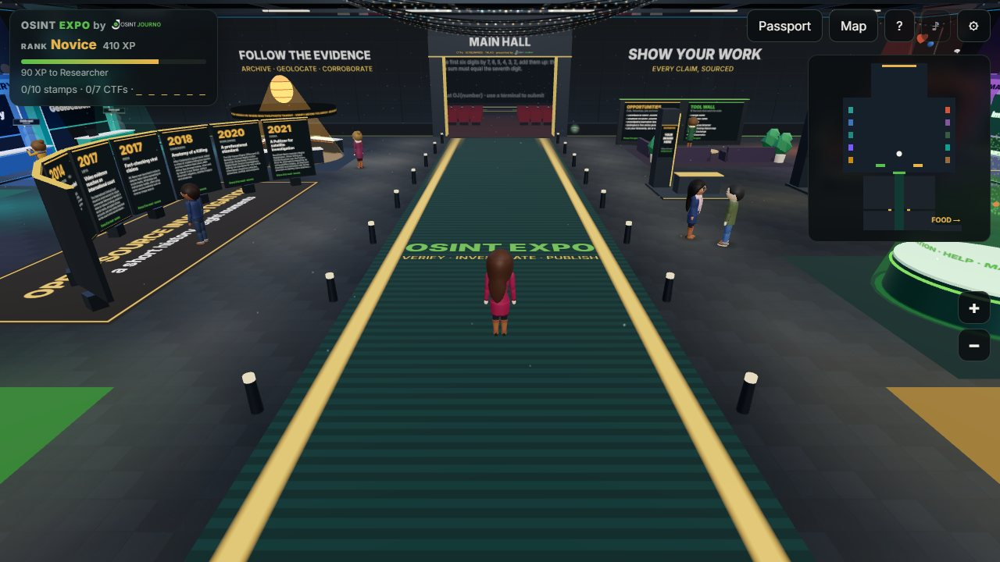

# OSINT Expo

**A free 3D expo you walk around to learn open-source investigation.** Play it in your browser at
**[expo.osintjourno.com](https://expo.osintjourno.com)**: no download, no account, and it works on phones.

Every stall teaches one skill in about two minutes, then quizzes you for a passport stamp. Try a hands-on lab, solve
a 20 to 30 minute case, crack CTFs in the Main Hall, join a live talk, or just walk to the food corner for chai.

This repository introduces the game. The game's code is not public.

## A look around

| | |
|---|---|
| 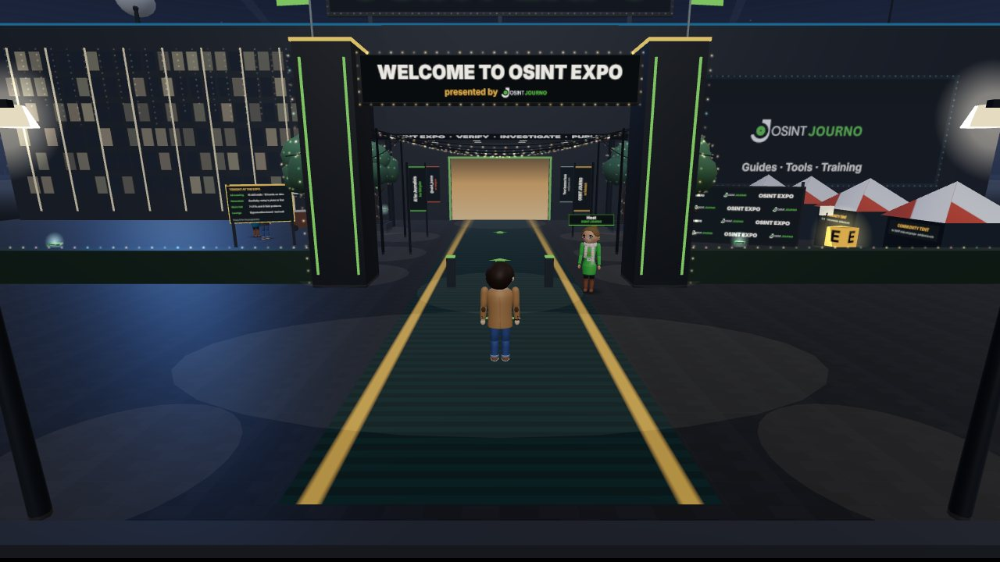 | 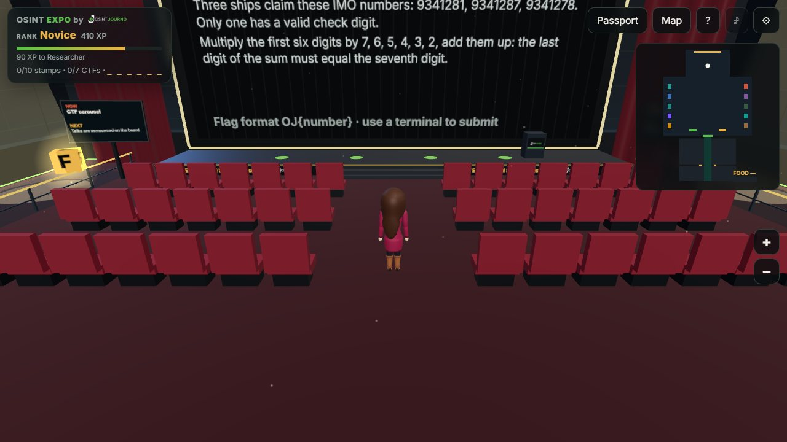 |
| **The entrance.** A host welcomes you at the gate on a cold night. | **The Main Hall.** CTFs, screenings and live talks on the big screen. |
| 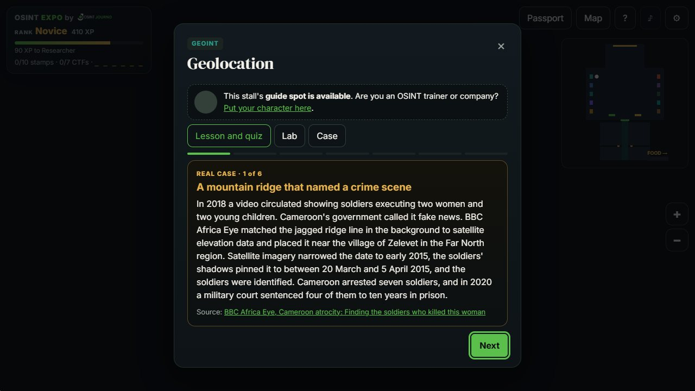 | 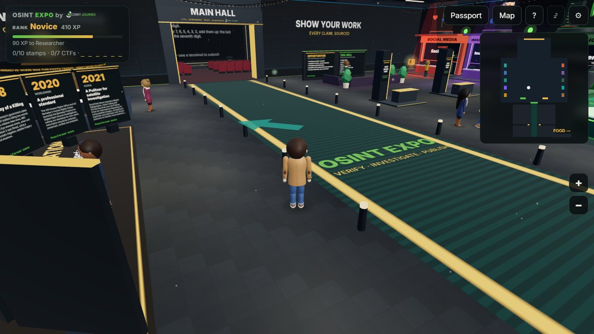 |
| **Lessons from real cases.** Each one names its source. | **Case File 001.** An arrow leads you from lead to lead. |
| 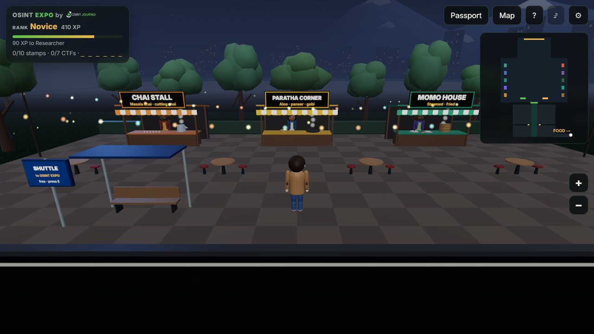 | 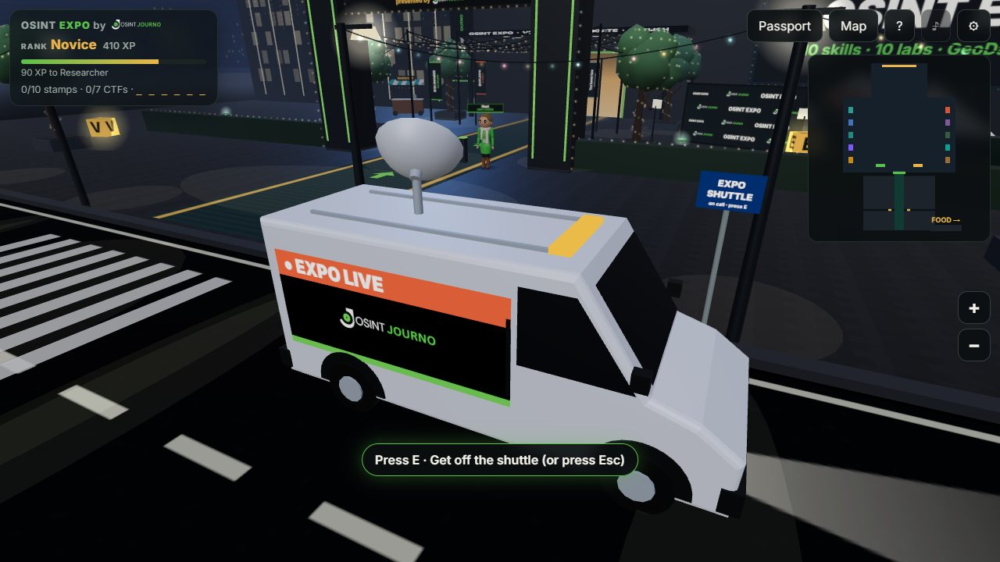 |
| **The food corner.** Chai, stuffed paratha and momos under the mountains. | **The shuttle.** A van runs between the gate and the food corner. |

  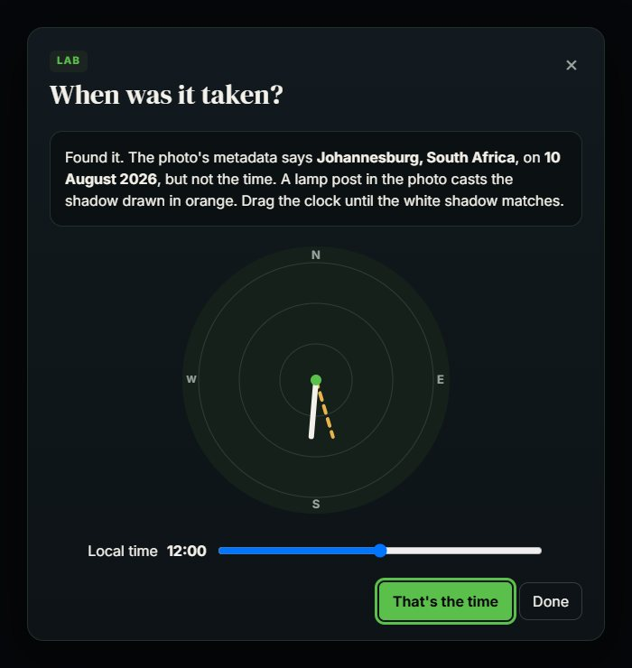
  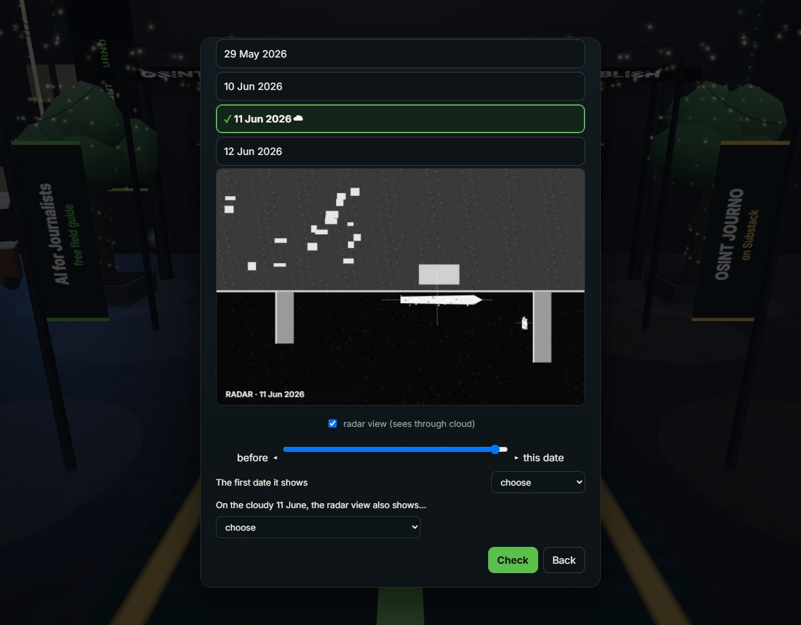
  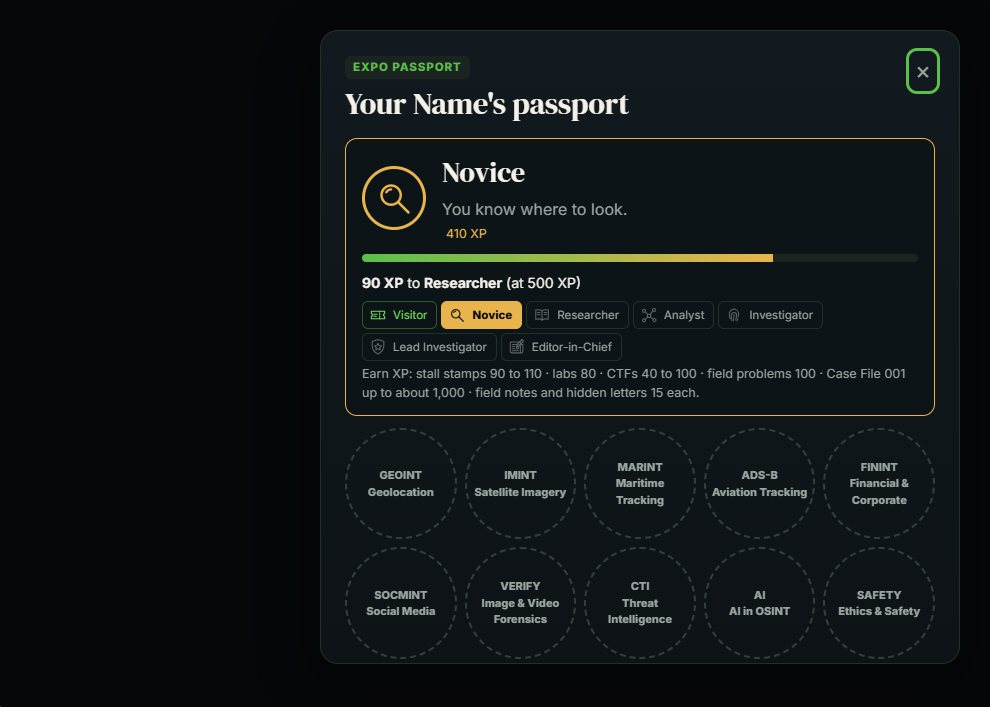

**Labs:** time a photo from its shadow. **Case File 001:** radar sees through the cloud over the quay. **Your passport:**
stamps, XP and your rank.

  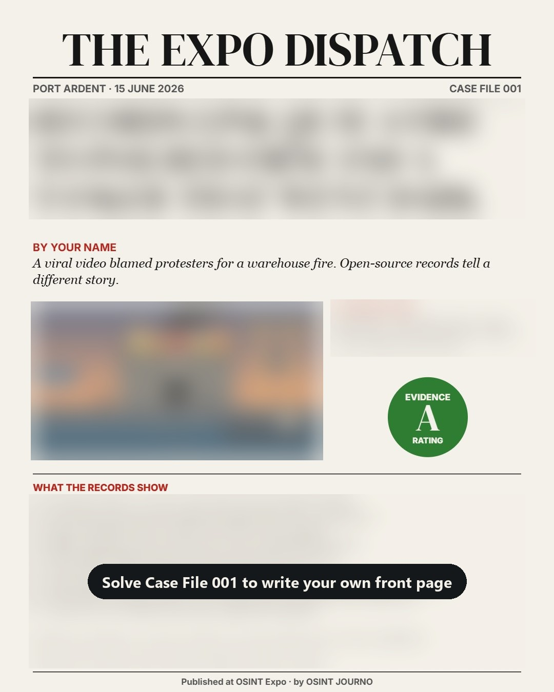
  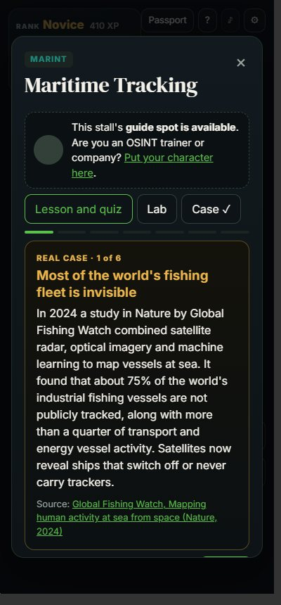
  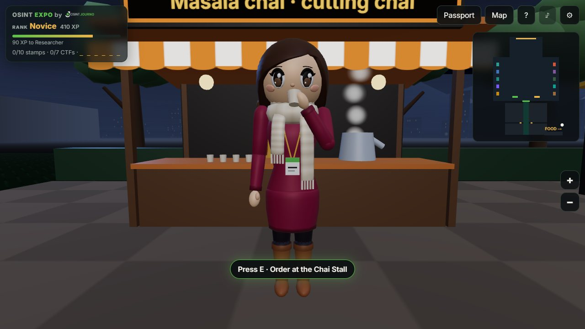

**Your front page:** finish the case and it's rated A to D (findings blurred here, no spoilers). **On your phone:**
an on-screen joystick, and a lite 2D mode for older phones. **Take a break:** order a chai between lessons.

## What's inside

- **Ten stalls, ten skills:** geolocation, satellite imagery, maritime tracking, aviation tracking, financial and
  corporate research, social media, image and video forensics, threat intelligence, AI in OSINT, and ethics and
  safety. The lessons are also on the web as [plain pages](https://expo.osintjourno.com/learn/index.html).
- **Hands-on labs** on every stall, with a fresh case each time: find the ship that went dark, follow a company's
  owners up the registry, catch an AI hallucination, time a photo from a shadow.
- **Case File 001, "The Quay 4 Fire":** a viral video, a fire, a tanker that went dark and a chain of companies. Follow
  ten leads across the stalls, then get your own newspaper front page, rated for accuracy and care.
- **CTFs and puzzles:** seven CTFs in the Main Hall, harder field problems solved with real tools (some need clues
  hidden in the world, like a street lamp flickering a word in Morse code), and GeoDaily, one photo a day to place.
- **Play together:** see other players, chat in the room or privately, and invite friends to a private room. Or play solo.
- **Live talks:** a programme with a countdown, speakers on stage with slides and live audio, and questions with votes.
- **Progress:** XP, seven levels from Visitor to Editor-in-Chief, six hidden letters, and a badge to share on LinkedIn
  when your passport is full.
- **Your character:** choose a look, jump, wave, sit in the hall or take photos in photo mode.

## Light, and open to everyone

- It runs in the browser with no install, and the first load is about 350 KB.
- **Lite mode** shows the whole expo as a 2D map for older phones.
- **Captions** for the announcer, full **keyboard** use, and **reduce motion**.
- **No accounts, no ads and no tracking cookies.** Your progress stays in your browser. In the shared room, other
  players see your chosen name, and chat messages are deleted after 24 hours.

## For trainers, newsrooms and companies

The expo has room for you: a guide at a sponsored stall, a pod in the hall, or a challenge or talk in the Main Hall.
See
[partners and prices](https://expo.osintjourno.com/partners.html). Writing about the expo? The
[press kit](https://expo.osintjourno.com/press.html) has screenshots and logos.

To suggest a lesson or report a mistake, see [corrections and suggestions](https://expo.osintjourno.com/policies.html).

## Follow

New cases and talks are announced on [Instagram (@osint_journo)](https://www.instagram.com/osint_journo/) and
[Substack](https://osintjourno.substack.com).

---

Made by [OSINT JOURNO](https://github.com/OSINT-JOURNO). Screenshots © OSINT JOURNO.
